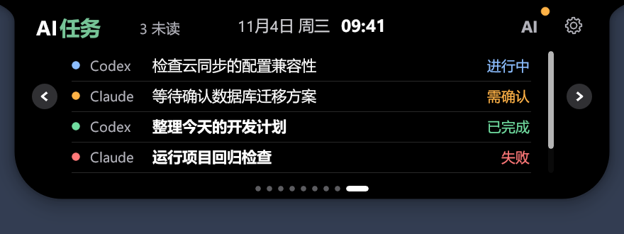
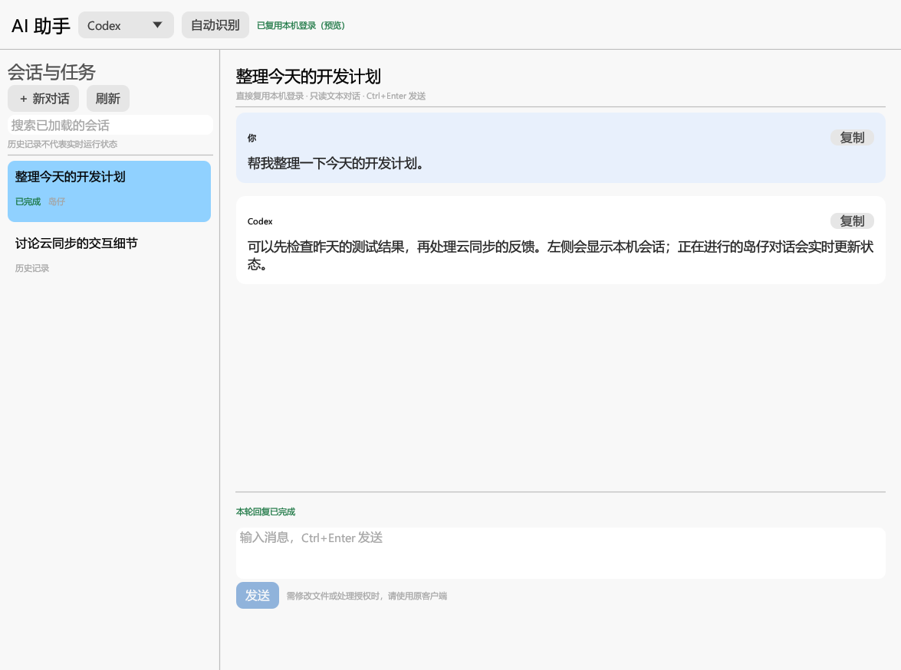
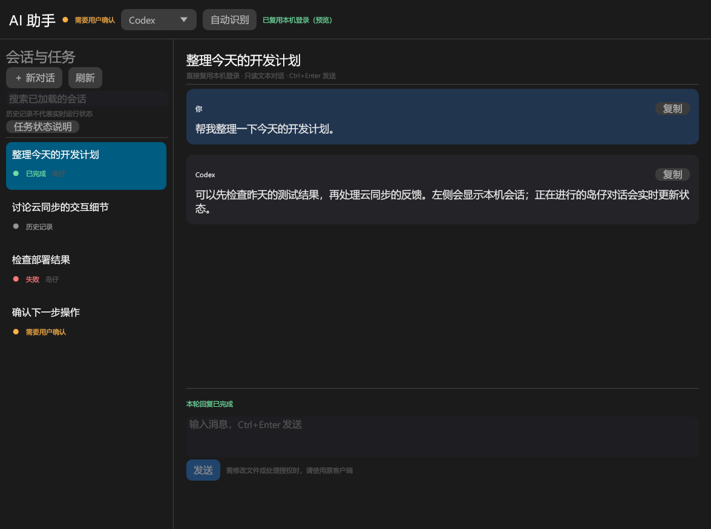

# 岛仔 AI 助手

展开小岛，点击右上角设置按钮旁的 **AI**，切换到岛内 **AI 任务**页面，也可以像邮箱一样通过左右箭头或底部圆点切换。小岛直接显示客户端、任务名称、状态灯和状态文字，列表可滚动；点击其中一项，直接打开对应对话，不再经过任务状态详情窗口。齿轮按钮始终打开设置，AI 接入选项保留在对话窗口左侧。无需在岛仔里填写 API Key。

「设置 → 常规 → 功能页面」可以显示、隐藏或调整 AI 任务页面的顺序。旧版八页配置升级时保留原顺序，将 AI 任务追加在末尾；保留原有页面开关。

任务名称优先使用 Codex 本机 `session_index.jsonl` 中与原客户端一致的名称，重命名后也会自动更新。没有名称索引时使用首次提问摘要；仍无法读取时显示「未命名任务」，不把会话编号当作任务名称。名称更新不会产生新的完成提醒或改变已读状态。



## 任务查看

- 小岛内集中显示每个任务的名称、客户端和状态，点击后直接打开对应对话。
- 点击一项仅标记该项已读，其他任务的未读提醒保留；单纯打开 AI 助手不会清空提醒。
- 每个任务完成、失败或需要确认时单独产生未读提醒；需要确认的任务即使已读仍保持橙灯，直到实际状态改变。
- 已读状态保存在本机 `ai-task-inbox.json`，与原客户端的已读标记分别管理，不加入云同步。
- 岛仔当前正在回复或读取对话时，需要结束后再切换任务；Claude 子任务详情仍需在原客户端查看。

## 自动识别

- **Codex**：发现本机 CLI 或受支持安装位置中的 Codex 程序，通过官方 App Server 接口读取登录与本机会话；复用该客户端当前使用的账号和模型配置。若有可用的本地 App Server 守护服务，优先连接它；否则启动岛仔自己的后台连接。
- **Claude Code**：发现本机 CLI 并查询实际登录状态，已登录时复用其身份；未登录时明确提示先在 Claude Code 中登录。仅有 Claude 网页版或桌面版额度凭据，不代表 Claude Code 已登录。
- 点击「自动识别」可重新检查安装与登录状态。客户端需要先在本机完成安装、登录；岛仔不会替你安装或自动切换账号。

本版接入 Codex 和 Claude Code。其他额度服务、仅存在于网页中的账号、远程 OpenClaw 代理尚不支持直接对话，不能由额度查询凭据推导出对话或任务接口。

## 对话

1. 自动识别后优先选择已登录的客户端，也可以在顶部切换。
2. 点击「新对话」，输入消息后点击「发送」，或按 **Ctrl+Enter**。
3. 回复会逐步显示；「停止回复」结束岛仔当前发起的回复。
4. 从左侧选择历史会话可以阅读最近的对话片段。在岛仔中继续外部会话时会创建副本，保留原会话；岛仔创建的对话可以持续多轮交流。

当前入口用于只读文本对话：Codex 使用只读策略，Claude Code 关闭工具、MCP 及自定义扩展加载。需要修改文件、执行完整开发任务或处理交互授权时，请使用原客户端。不会自动批准工具权限，也不会替其他客户端停止任务。

## 会话与任务状态

- 左侧展示本机最近的会话，支持刷新、加载更多和搜索已加载的会话。
- 任务列表和对话窗口使用同一套状态灯：红灯表示执行失败，绿灯表示执行完成，橙灯表示需要用户确认；蓝灯表示正在执行，灰灯表示空闲、已停止或状态未知。
- 悬停小岛上的 AI 入口、窗口顶部状态或任务状态灯可查看说明，左侧也有「任务状态说明」入口。需要确认的任务优先显示橙灯，授权操作仍在原客户端处理。
- 岛仔发起的回复按真实事件更新状态；打开窗口不会把失败提示改成绿灯，也不会清除已确认的完成状态。
- AI 状态通过收起后的小精灵眼睛提示：蓝色表示任务处理中，蓝色双眼会以约 2 秒一个往返周期平滑左右移动，绿色表示有完成未读的任务，红色表示失败未读，橙色表示需要确认；无进行中任务或未读结果时恢复默认眼睛颜色。多个任务并行时按需要确认、失败未读、完成未读、执行中的顺序显示。逐项查看后只清除对应未读，需要确认的状态保持到任务实际继续。历史记录不触发绿眼睛。已取消岛边发光和 AI 按钮旁的全局状态点；任务列表仍保留每项的状态灯。眼睛遵循小精灵开关及原有收起显示规则。
- 原客户端里的任务由独立的本机监听器采集，不需要在岛仔中重新发起。默认显示全部客户端任务，可以取消「显示全部客户端任务」只看当前客户端。监听器与聊天连接分开，外部任务的事件不会中止岛仔当前回复。
- 监听器每 2 秒增量读取已发现的会话记录，每 10 秒发现新记录；读取 Codex 的明确开始、完成、中断事件，以及 Claude Code 的消息和结束标记。启动时读取的旧记录不会触发完成提醒。没有可确认事件的状态仍显示为历史记录；连续 10 分钟没有新事件的执行中任务退回未知状态，避免永久显示运行中，此时并不代表任务已经停止。
- 窗口打开且没有进行中的岛仔回复时，每 30 秒刷新列表；窗口关闭后，当前回复仍可继续，完成后产生任务未读提醒，并通过眼睛颜色提示。
- 这里的任务指本地 AI 会话及回复状态，不包含 Codex Cloud 任务、远程 OpenClaw 任务或全部第三方服务后台作业。

## 接入原客户端实时事件

Windows 版启动后会自动配置已存在的本机 Codex / Claude Code 配置目录，在 `hooks.json`（Codex）或 `settings.json`（Claude Code）中追加岛仔事件处理器，不替换其他工具的处理器。支持 `CODEX_HOME` 和 `CLAUDE_CONFIG_DIR`。不扫描其他 Windows 用户、WSL 或远程机器的配置。首次修改已有配置前，在同目录保存 `.daozai-backup.json` 备份；原配置无法解析时保留原文件，并在界面显示原因。

1. 更新岛仔后，重启 Codex / Claude Code，让它们重新加载事件配置。
2. **Codex 需要在「设置 → Hooks」或 CLI 的 `/hooks` 中审核并信任岛仔脚本。** 岛仔不会代替用户信任脚本。配置成功不代表已获得信任，权限提示仍在原客户端处理。
3. AI 窗口左侧显示接入说明；「重新接入」用于修复或重新开启，「关闭实时事件」仅移除岛仔处理器，保留其他处理器。本地会话记录监听仍然可用。

事件通过系统内置 PowerShell 写入岛仔数据目录的 `ai-monitor/events`，不开放网络端口，不需要 Node.js 或额外账号。事件文件只包含会话编号、事件类型、时间和少量状态字段，不保存提示词、回复、工具参数。队列最多保留 1024 条，岛仔消费后删除；关闭岛仔期间积累的旧事件不会在下次启动时批量触发完成提醒。`ai-monitor/disabled` 保存实时事件关闭状态。

收到权限请求或明确的用户输入请求时显示橙灯，后续工具继续执行时恢复蓝灯。Stop/完成表示**本轮执行结束**，不等于整个项目完成；已经收到启动事件的子任务未结束时，不提前将主任务标记完成。Claude 子任务记录单独显示，避免其回复结束污染主会话状态。工具的一次失败不直接等同于整个任务失败；明确的终止错误才显示红灯。不同客户端版本可能缺少部分事件，不能承诺覆盖全部后台任务；没有证据时保持未知状态。

每个客户端最多监听最近 100 个记录文件，界面最多保留最近 200 个任务及 7 天内状态；首次读取大文件只取最近 2 MiB，之后从上次位置继续读取。需要更完整的历史时仍可通过原有会话列表查看。

实现思路参考 [CodexMonitor](https://github.com/Dimillian/CodexMonitor) 的服务事件处理，以及 [Claude-Code-Agent-Monitor](https://github.com/hoangsonww/Claude-Code-Agent-Monitor) 的事件与本地记录互补方式；岛仔使用独立 Rust 实现，不引入其 Web 服务。

## 本机数据与连接

岛仔不将客户端登录令牌复制到自身配置，不把聊天历史加入 WebDAV 云同步。对话由所选 AI 服务处理，并遵循其登录与额度限制；客户端仍按自己的规则保存会话记录。

岛仔数据目录的 `ai-assistant-sessions.json` 仅保存岛仔创建的会话编号，用于区分可直接继续的会话与需要创建副本的外部会话。`ai-workspace` 是岛仔文本对话的独立工作目录，不默认以用户当前项目作为写入目标。

已在 Windows 上使用 Codex CLI 0.154.0 完成本机登录复用、历史读取、两轮流式对话和停止回复验证。Claude Code 2.1.220 已完成安装/登录状态识别；当前测试机器的 Claude Code 未登录，未宣称完成其真实推理验证。旧版客户端若不支持相关协议或命令，需要先升级。

## 界面预览

以下界面使用合成会话，不包含真实账号或对话内容。





任务处理中（蓝色眼睛）：


任务完成未读（绿色眼睛）：


## 开发验证

```powershell
cargo test --locked --lib ai_assistant -- --test-threads=1
cargo check --locked --all-targets --features record
```

真实账号联调默认忽略。手动执行时必须设置隔离的 `DAOZAI_DATA_DIR`；测试会消耗少量账号额度，并在成功后将测试会话归档。不要在公共 CI 中运行真实账号测试。

接口参考：[Codex App Server](https://learn.chatgpt.com/docs/app-server)、[Claude Code 程序化调用](https://code.claude.com/docs/en/headless)。
